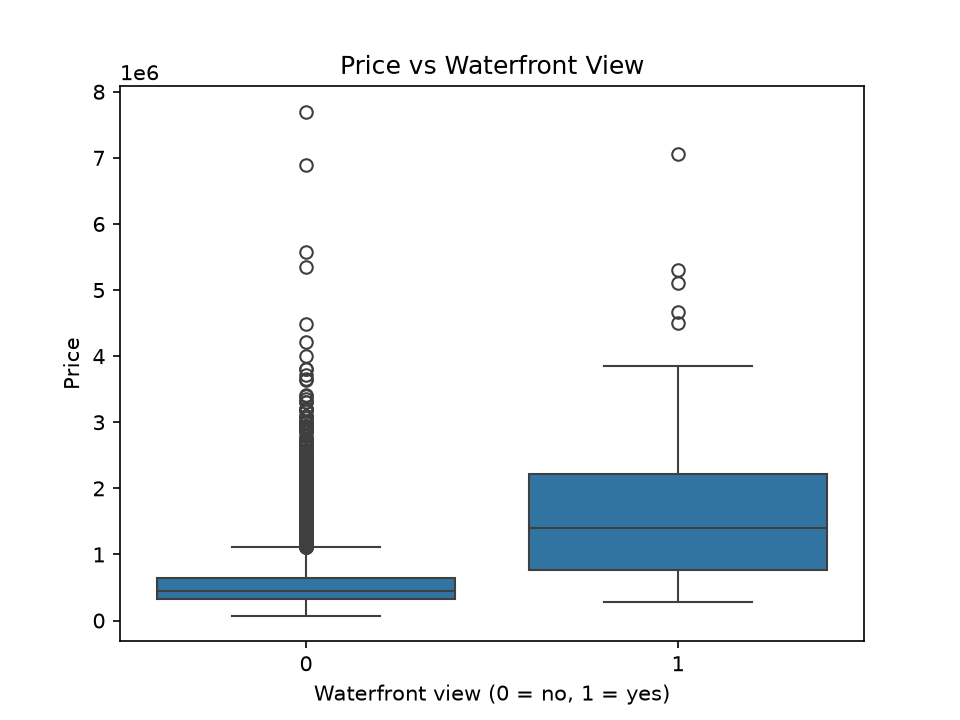
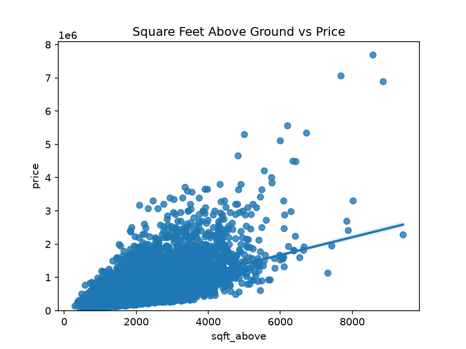
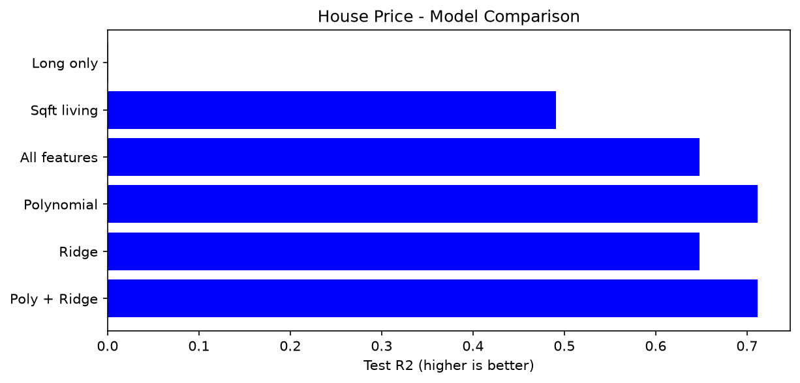

# House Price Prediction

Predicting house sale prices in King County, USA, using Linear, Polynomial and Ridge Regression in Python.

## About

- **Goal:** Find which house features affect price the most, and predict price from them.
- **Data:** 21,613 house sales in King County from the IBM Data Analyst Professional Certificate.
- **Tools:** Python, pandas, NumPy, Matplotlib, Seaborn, scikit-learn

## Data Snapshot

- Average price is about $540,000 and the median is $450,000. Prices range from $75,000 to $7.7 million.
- Only 23 values were missing: 13 in `bedrooms` and 10 in `bathrooms`.
- Most houses have 1 floor (10,680) or 2 floors (8,241).

## What I Did

1. Cleaned the data and filled missing bedrooms and bathrooms with the average.
2. Explored price against waterfront view, living area and other features.
3. Split the data into training (85%) and test (15%) sets.
4. Compared 6 models: Linear (1 feature and 11 features), Polynomial, Ridge and Polynomial Ridge.

## Charts

**1. Price vs Waterfront View** : 
Houses with a waterfront view have a much higher median price ($1.4 million) than houses without ($450,000).



**2. Living Area vs Price** : 
Bigger houses tend to sell for more, but the spread grows as size increases.



**3. Model Comparison** : 
The Polynomial models have the highest Test R² (0.71).



## Results

| Model | Test R² | Test RMSE |
|---|---|---|
| Linear - sqft_living only | 0.49 | $273,395 |
| Linear - all features | 0.65 | $227,393 |
| Polynomial + Linear | **0.71** | **$205,748** |
| Ridge | 0.65 | $227,395 |
| Polynomial + Ridge | **0.71** | **$205,748** |

**Best model:** Polynomial Regression, with a Test R² of 0.71 and an average error of about $206,000.
**Key finding:** `sqft_living` (0.70) and `grade` (0.67) have the strongest link with price. Using all 11 features raised R² from 0.49 to 0.65, and adding polynomial terms raised it to 0.71.

## Limitations

- Data is from one US county (2014-2015), so it does not apply to other places.
- Default model settings were used, with no tuning.
- Outliers were kept, for example one house listed with 33 bedrooms.

## How to Run

```bash
pip install -r requirements.txt
python house_price_prediction.py
```

Charts are saved in the `images/` folder.

## Credits

Based on an IBM Data Analyst Professional Certificate (Coursera) lab. I added a proper train/test evaluation, RMSE scores and saved charts.
